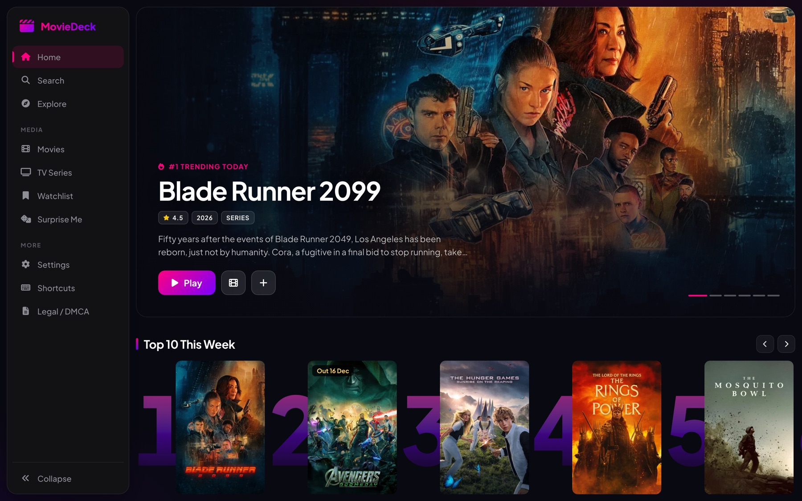
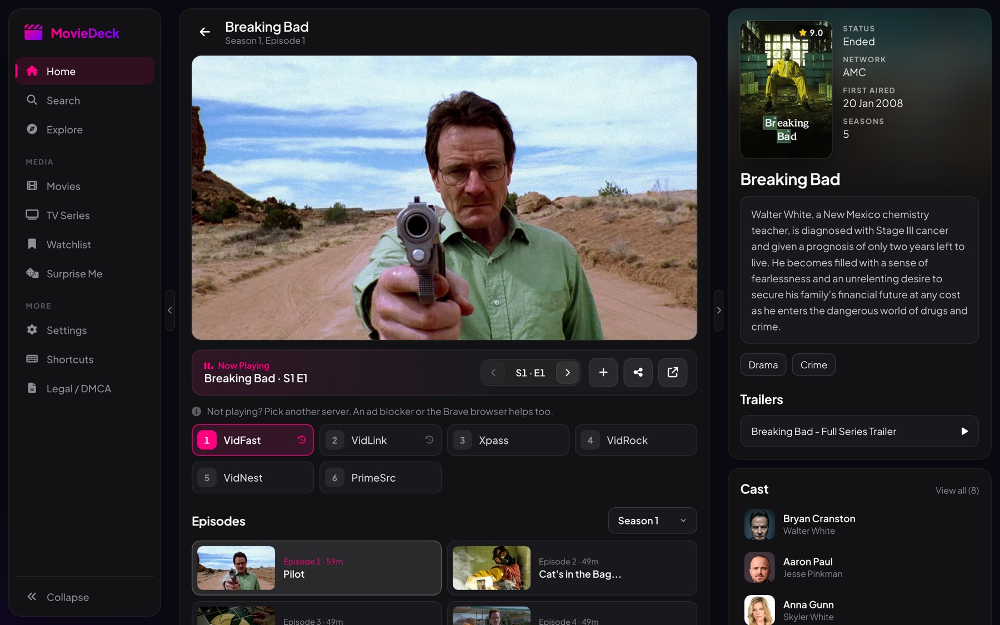
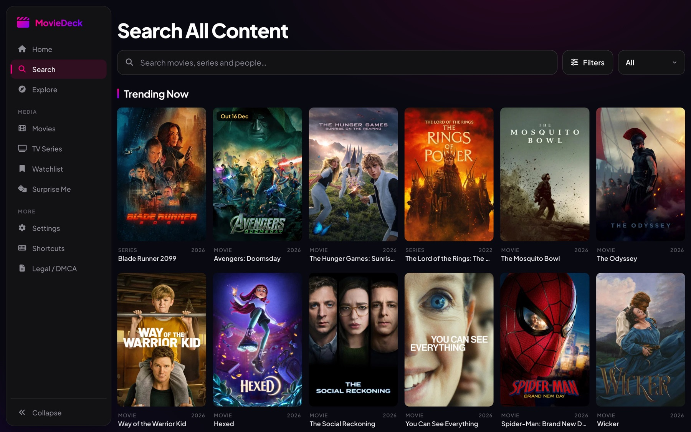
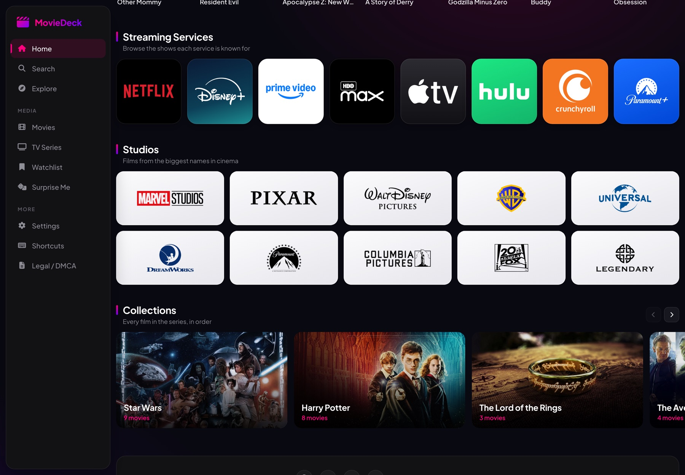
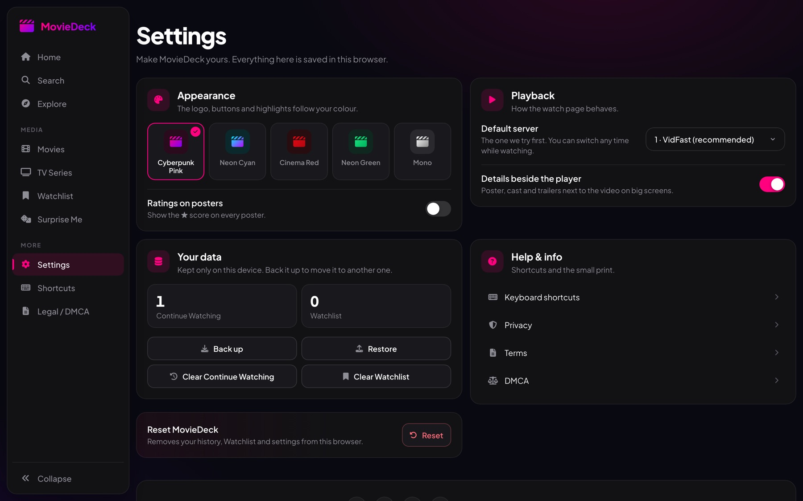
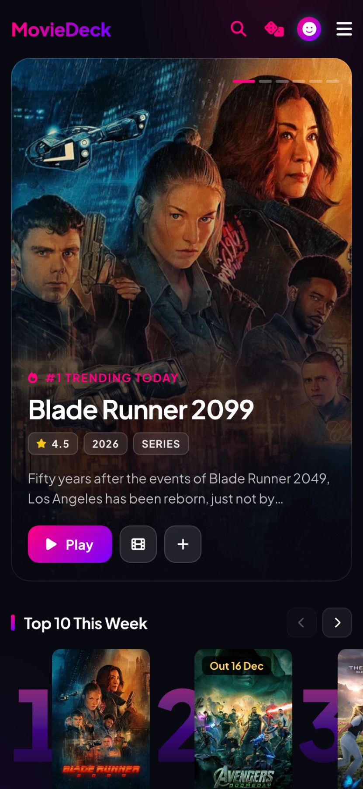
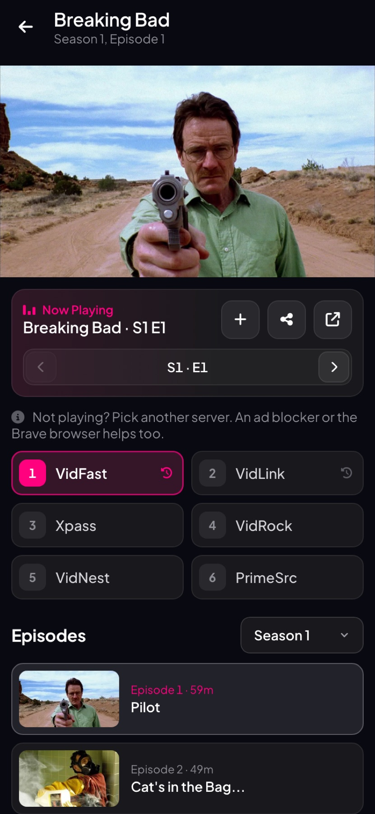

<div align="center">

# 🎬 MovieDeck

**Browse, discover and watch movies and series, all in one place.**

[](https://moviedeck.xyz)


[**Open MovieDeck →**](https://moviedeck.xyz)



</div>

---

## About

MovieDeck is a single-page web app for finding something to watch. You can search, browse trending titles, watch trailers, check the cast and pick up where you left off. Everything is on one page and nothing makes you jump between tabs.

It's built with plain HTML, CSS and JavaScript. There is no framework, no build step and no backend. All the data comes from [The Movie Database (TMDB)](https://www.themoviedb.org/), and your watchlist, history and settings stay in your own browser.

---

## Features

### 🏠 Home
- A **hero slideshow** of what's trending today, with the rating, year and type at a glance
- **Top 10 This Week** rows for everything, series only and movies only, each with large ranked numbers
- **Continue Watching**, which remembers the season, episode and server you were on
- Rows for popular, genre and regional picks that load as you scroll
- **Streaming services** (Netflix, Disney+, Prime Video, HBO Max, Apple TV+, Hulu, Crunchyroll and Paramount+), **studios**, and full film **collections** such as Star Wars, Harry Potter and The Lord of the Rings

### ▶️ Watch page
- Click any poster and it opens straight into a **dedicated watch page**
- **6 servers** to switch between, with your preferred one remembered
- **Season and episode picker** with thumbnails, plus next/previous episode buttons
- A side panel with the poster, rating, status, network and air date, plus the overview, genres, trailers and cast
- **Recommended** titles right below the player
- Add to your watchlist, share, or open the stream in a new tab
- Both sidebars collapse when you want more room for the video

### 🔍 Search
- One search box for movies, series and people
- **Filters** for type, genre and year, and sorting by popularity, rating or release date
- Shows trending titles before you start typing

### ⚙️ Settings
- **5 colour themes** (Cyberpunk Pink, Neon Cyan, Cinema Red, Neon Green and Mono). The logo, buttons and even the browser-tab icon change with the theme.
- Choose a default server, show or hide ratings on posters, and turn the details panel on or off
- **Back up and restore** your watchlist and history, or clear them

### ✨ Extras
- **Surprise Me** picks a random title by genre
- **Keyboard shortcuts:**

  | Key | Action |
  | --- | --- |
  | `/` | Search |
  | `N` / `P` | Next / previous episode |
  | `Esc` | Close |
  | `?` | Show all shortcuts |

- Works on **phones, tablets and desktops**, with a sidebar on large screens and a compact top bar on mobile

---

## Screenshots

### Watch page


### Search


### Streaming services, studios and collections


### Settings


### On mobile
<p align="center">
  
  &nbsp;&nbsp;
  
</p>

---

## Run it locally

You don't need to install anything. Clone the repo and serve the folder:

```bash
git clone https://github.com/itzzharshil/MovieDeck.git
cd MovieDeck
python3 -m http.server 5173
```

Then open [http://localhost:5173](http://localhost:5173).

### Project structure

```
MovieDeck/
├── index.html      # App shell: sidebar, pages, watch page
├── script.js       # Routing, TMDB requests, player, search, settings
├── style.css       # Base styles and themes
├── ui.css          # Current layout: sidebar, rows, watch, search and settings pages
├── sw.js           # Service worker
├── manifest.json   # Installable web app info
├── 404.html        # Not-found page
├── tools/
│   └── build_seo.py  # Builds the crawlable title, genre and sitemap pages
├── movie/ tv/ genre/ collection/ person/  # Generated pages (updated daily by GitHub Actions)
└── assets/         # Images, icons and screenshots
```

### Pages for search engines

The app fills in its content with JavaScript, so on its own a search engine mostly sees one page. A GitHub Action runs [`tools/build_seo.py`](tools/build_seo.py) every day. It writes a real HTML page for each popular movie and series, such as `/movie/interstellar-157336/`, with the overview, cast, trailer, where to stream and similar titles. It also writes genre pages, "movies in order" pages for film series such as Star Wars and Harry Potter, pages for actors and directors, and `sitemap.xml`. New and changed pages are sent to Bing and other search engines through IndexNow. Pages are never removed, so links that search engines have already indexed keep working.

You can run it yourself with `python3 tools/build_seo.py`.

---

## Challenges

- **Staying within API limits.** The home page loads a lot of rows. Rows only fetch once they scroll into view, and the streaming-service, studio and collection data is cached for a week.
- **One page, many views.** Home, search, settings and the watch page all live on a single page. Each one has its own URL (for example `?tv=1396&s=1&e=1`), so the back button, sharing and refreshing all work as you'd expect.
- **Missing data.** Some titles don't have a poster, trailer or full details. MovieDeck falls back to something sensible instead of leaving gaps in the grid.
- **No flashes while loading.** The logo waits for its font before it appears, and the hero preloads its backdrops, so nothing jumps around while the page loads.

---

## Ideas for later

- Accounts, so your watchlist syncs across devices
- Filters by actor, director and rating
- A custom player wrapper so every server looks and works the same

---

## Credits

- Movie and TV data from [TMDB](https://www.themoviedb.org/). This product uses the TMDB API but is not endorsed or certified by TMDB.
- Icons by [Font Awesome](https://fontawesome.com/)
- Font: [Plus Jakarta Sans](https://fonts.google.com/specimen/Plus+Jakarta+Sans)

> MovieDeck doesn't host any media. All streams come from third-party services.

<div align="center">

Built with ❤️ by Harshil

</div>
